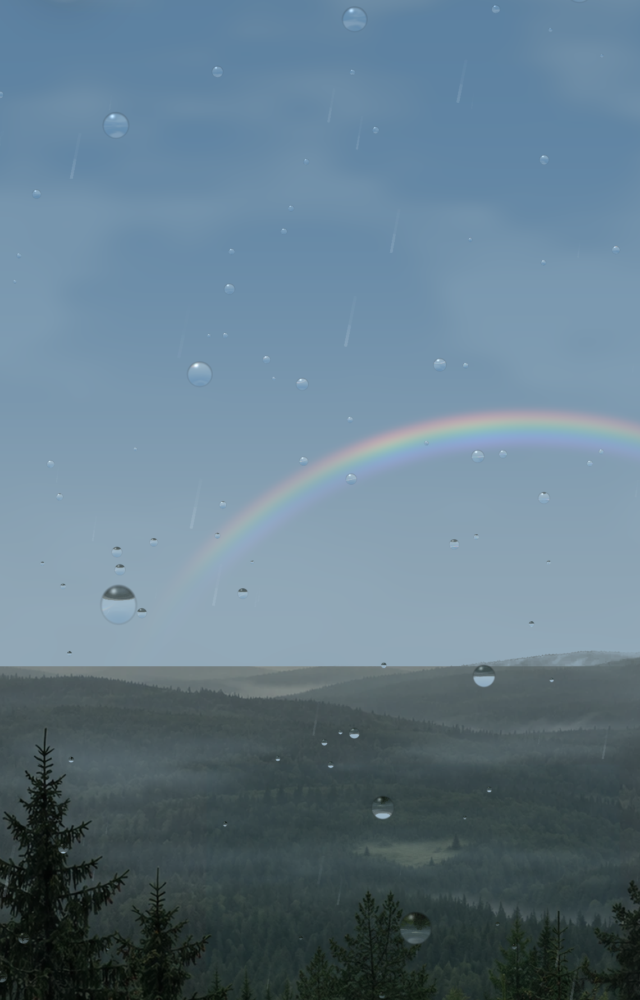
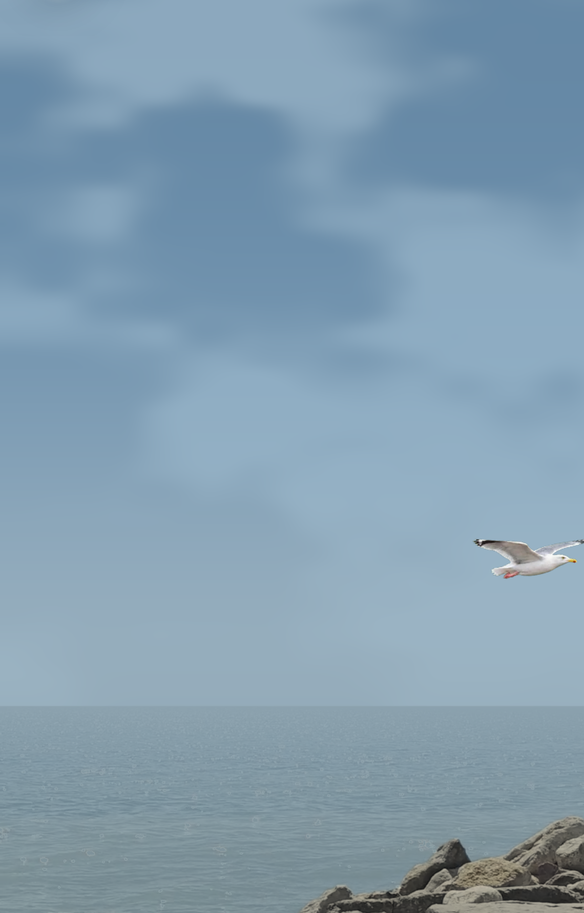
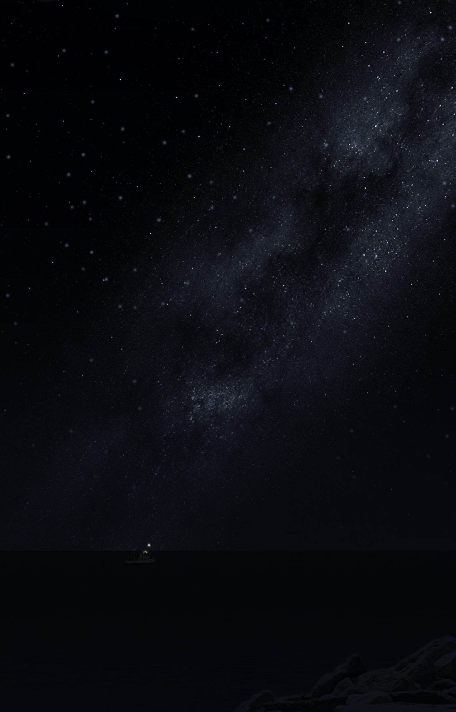
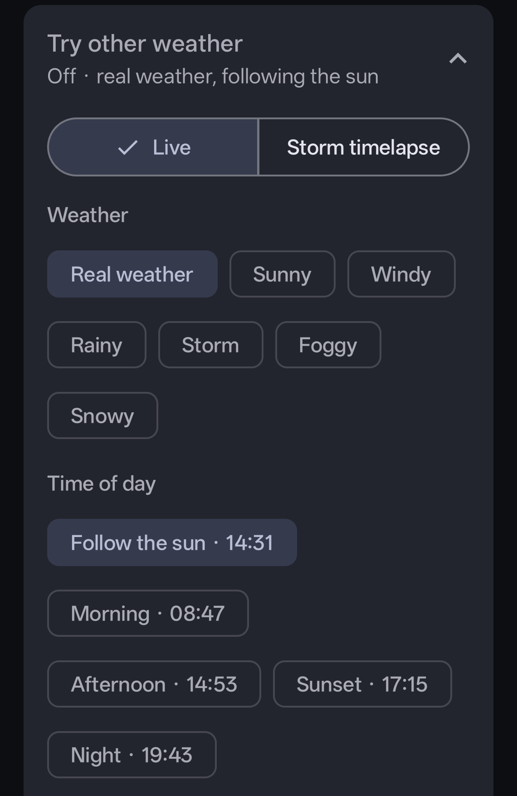

# Weatherscape

Android live wallpapers that follow the real weather and the sun where you are. Each scenery shares
one sky drawn by OpenGL ES 2 shaders: drifting cloud, rain, snow, lightning, the real moon, stars and
the Milky Way. Raindrops and condensation gather on the camera glass. A home-screen widget shows the
conditions and the next change in the forecast.

- **Pine Valley**: one photographic plate brought to life, with fog, wind in the trees and rare
  moments (birds, deer, an owl, fog rolling in, aurora and more) when the conditions fit.
- **Rock Jetty**: a stabilised, levelled, seamlessly looping phone video of the sea and rocks under
  the drawn sky. The water greys under cloud, hazes in fog and rain, darkens at night with a moonlit
  path, and the rocks darken while wet. Its own moments: a herring gull sweeping past (also on a tap),
  gulls wheeling, a cormorant, a yacht, a fishing boat, a cargo ship, a jet ski, a hot-air balloon and
  an airliner with its contrail (lights only at night). Their sprites are image-model renders cut out
  of a chroma-key background.

Weather comes from [Open-Meteo](https://open-meteo.com) (CC BY 4.0), with no account or key. No ads,
no analytics, no tracking.

<p>
  
  
  
  
</p>

## Install

Download `weatherscape-<version>.apk` from [Releases](https://github.com/cv4ever/weatherscape/releases)
(Android 11 or later). Signing certificate SHA-256:
`195bcd784da458829db1cb850cd94d69c896d0520b3d0bf8dbc2dcc736c4168f`.

## Build and install

Needs JDK 17 and the Android SDK (path in `local.properties`, which is not committed).

```sh
./gradlew :app:testDebugUnitTest :app:assembleDebug
adb install -r app/build/outputs/apk/debug/app-debug.apk
```

Then open Weatherscape and tap **Set as wallpaper** under the scenery you want.

## Release

1. Raise `versionCode` and `versionName` in `app/build.gradle.kts` and add
   `fastlane/metadata/android/en-US/changelogs/<versionCode>.txt`.
2. Commit, then push a tag `v<versionName>`.

The Release workflow builds the APK on Linux, signs it after the build with the Weatherscape key
(GitHub secrets `WEATHERSCAPE_KEYSTORE_B64` and `WEATHERSCAPE_KEYSTORE_PASSWORD`, backed up in
Bitwarden) and attaches it to the release. F-Droid builds the same tag and publishes it with this
signature when its unsigned build matches byte for byte (reproducible builds). Never let Gradle sign
the release: the APK must stay identical to an unsigned build.

## Layout

| Path | What |
|---|---|
| `Scenery.kt` | The wallpapers on offer, each with its own service so the system picker lists it |
| `SceneDirector.kt` | Turns weather, time, sun, moon and season into one `Frame` of scene values; schedules moments |
| `SceneRenderer.kt` | GL thread: draws the landscape pass, overlays, then the glass (mist and drops) |
| `assets/shaders/sky.glsl` | The shared sky, prepended to each scenery's shader |
| `assets/shaders/landscape.frag` | Pine Valley: light, fog, rain haze, snow cover, sunbeams, rainbow |
| `assets/shaders/jetty.frag`, `VideoLoop.kt` | Rock Jetty: the video as an external texture, graded by the weather |
| `tools/rock_jetty_video.py` | Rebuilds Rock Jetty's video and sea mask from the source clip |
| `Overlays.kt` | Rain, snow and moment geometry (sprites from the atlases in `assets/textures`) |
| `LensDrops.kt`, `glass.frag`, `mist.frag` | Raindrops, splashes and condensation on the camera glass |
| `Weather.kt`, `WeatherRefresher.kt` | Open-Meteo fetch, cache and mapping to the scene's atmosphere |
| `SceneryWallpaperService.kt` | Wallpaper engine: frame pacing, unlock and tap events, previews |
| `SettingsActivity.kt`, `Settings.kt` | Settings screen and the preferences shared with the engine |
| `ConditionsWidget.kt` | Home-screen widget |

## Power

The engine draws at the chosen frame rate only while something moves fast (rain, snow, strong wind,
lightning, a moment, water on the glass). While the valley only drifts it drops to 15 fps
("Save power when calm"). Reduced motion and Battery Saver redraw twice a minute, and nothing
renders while the wallpaper is hidden. Rock Jetty's water always moves, so it draws at the chosen
frame rate while visible and pauses its video in the still modes.

## Notes

- Adreno GPUs break arithmetic shader hashes at large coordinates, so value noise reads a
  256×256 random texture instead.
- The HTML prototypes the effects were designed in are not part of this repository.
- Store listing text, icon and screenshots for F-Droid live in `fastlane/metadata/android`.

## License

Code: [GPL-3.0-or-later](LICENSE). Images, video and sprite atlases in `app/src/main/assets` and
`app/src/main/res`: [CC BY-SA 4.0](https://creativecommons.org/licenses/by-sa/4.0/). The Rock Jetty
video is Carlos's own footage; the Pine Valley plate, the sky textures and the animal and vessel
sprites are image-model renders.

## Author

Made by [Carlos Oliveira](https://carlosoliveira.me/).
