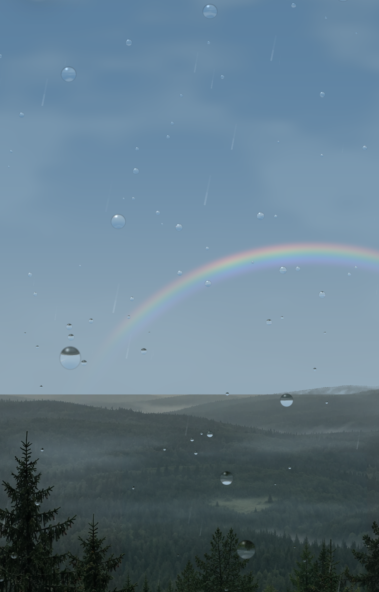
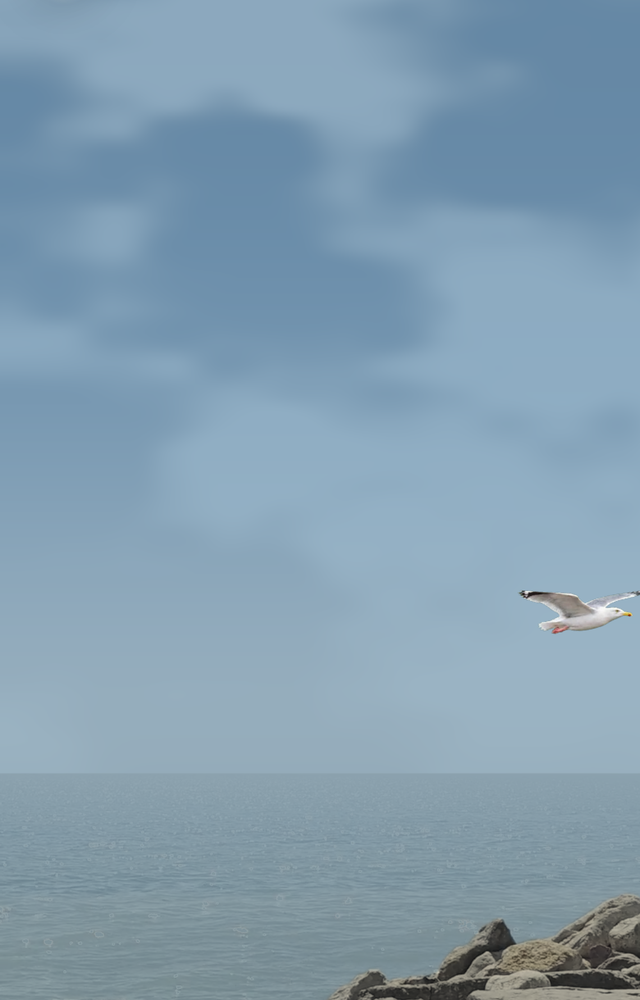
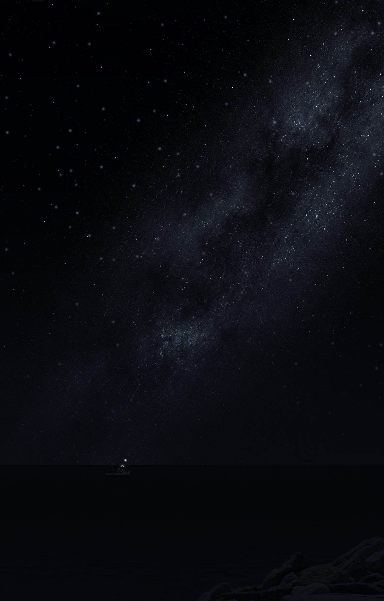

# F-Droid

Weatherscape goes into the main F-Droid repository through a merge request to
[fdroid/fdroiddata](https://gitlab.com/fdroid/fdroiddata) from the fork `cv4ever/fdroiddata`.

## State

- Metadata: branch `me.carlosoliveira.weatherscape` of `cv4ever/fdroiddata`, file
  `metadata/me.carlosoliveira.weatherscape.yml`. Its CI pipeline builds the app and checks that
  F-Droid's unsigned build matches the signed APK on GitHub Releases.
- Not submitted yet. The inclusion policy (Quality point 6) wants about 3 months of active
  development. The first commit is 2026-11-21, so open the merge request from 2027-02-22. On
  2026-11-27 reviewer linsui closed Carlos's previous submission (!59408, Breakdown Log) for that
  rule and for not following the merge request template.
- Signing: reproducible builds with the Weatherscape key (`Binaries` and `AllowedAPKSigningKeys` in
  the metadata). F-Droid ships the APK under that signature, so GitHub and F-Droid installs update
  each other. The key is in Bitwarden (`WEATHERSCAPE_RELEASE_KEYSTORE_B64`, `..._PASSWORD`).

## Before opening the merge request

1. Point the metadata's `Builds` entry, `CurrentVersion` and `CurrentVersionCode` at the latest
   release tag (full commit hash in `commit`). Keep only that one version.
2. Sync the branch with upstream `master` when it conflicts. Don't rebase otherwise.
3. The branch pipeline is green, including `fdroid build`.

## Merge request

Title: `New app: Weatherscape`. Body: the template below, every box ticked.

```markdown
## Abstract for new app inclusion

### Please introduce the functions and usage of your app in summary, and also attach some screenshots.

Weatherscape is a set of Android live wallpapers that show the real weather where you are. Rain,
fog, snow, lightning, clouds, the sun's position, the moon in its current phase and the stars are
drawn live with OpenGL ES 2 shaders over two sceneries: Pine Valley (a forest valley with rare
wildlife moments) and Rock Jetty (a looping video of the sea from a rock jetty, with gulls and
boats). Raindrops gather on the camera glass when it rains. A home-screen widget shows the
conditions and the next forecast change. Weather comes from Open-Meteo, with no account; location
is approximate or a chosen city. No ads, analytics or tracking.

| | | |
|---|---|---|
|  |  |  |

### Please elaborate why you wrote this app. Please highlight the unique functions it provides over other similar apps in F-Droid.

I wanted my home screen to show what the sky outside is doing. Weather apps show it as numbers and
icons; Weatherscape renders the actual local weather, sun, moon phase and stars onto a
photographic scene, and saves battery by slowing to 15 fps when the scene is calm and drawing
nothing while hidden.

## Checklist

### Policy

* [x] The app complies with the inclusion policy. Developed since 2026-11-21.
* [x] The original app author has been notified (I am the author).
* [x] The upstream repo has Fastlane metadata with en-US summary, description, icon, screenshots and changelog.

### Docs

* [x] Please read the guide first if this is your first contribution.
* [x] Please make sure your metadata follows the best practice in our templates.
* [x] Please read the Build Metadata Reference and make sure your metadata is valid.
* [x] Please read the Quick Start Guide.

### Merge Request Setup

* [x] The title of this merge request follows "New app: app name".
* [x] My fdroiddata fork is public and the branch is not protected.
* [x] I read the Git guide.
* [x] All related fdroiddata and RFP issues have been referenced: none.
* [x] Only one app in this MR.

### Metadata

* [x] Metadata is in `metadata/me.carlosoliveira.weatherscape.yml`.
* [x] Metadata is valid YAML.
* [x] Metadata uses LF line endings.
* [x] No summary, description, changelog or images in this MR; they are upstream.
* [x] Releases are tagged and auto update is enabled.
* [x] Issue tracker: https://github.com/cv4ever/weatherscape/issues, author site: https://carlosoliveira.me/
* [x] AuthorName is set.
* [x] No external repos or srclibs.
* [x] Reproducible builds are enabled (`Binaries`, `AllowedAPKSigningKeys`).
* [x] No ABI split needed: no native code of its own.
* [x] Only the latest version is in the metadata.
* [x] No disabled versions.
* [x] `commit` is the full hash.

### Pipeline

* [x] All pipelines pass.
* [x] All warnings and errors in the Reports tab are fixed or explained.

Disclosure: most of the code was written with Claude (AI) under my direction and tested on my
phone. The Pine Valley plate, sky textures and animal and vessel sprites are image-model renders,
licensed CC BY-SA 4.0 with the app; the Rock Jetty video is my own footage.

/label ~"New App"
```
